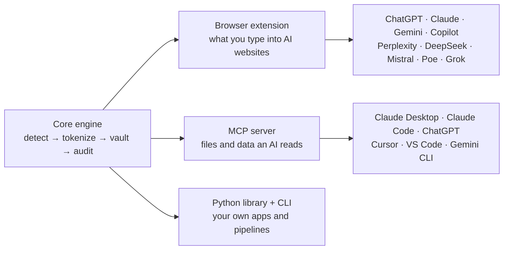

# 🛡️ PII Firewall

**Stop personal information from reaching AI models.** PII Firewall finds Social Security numbers, card numbers, phone numbers, emails, addresses, dates of birth and names, and swaps them for tokens like `[SSN_1]` *before* ChatGPT, Claude, Gemini or any other AI sees them.

AI makes identity fraud cheap: with a name, SSN, phone and photo, a model can fill out a credit card application in seconds. The less personal data we hand to AI tools, the less there is to leak, log, train on or misuse.

[](https://github.com/LavanyaRamamurthyV/pii-firewall/actions/workflows/ci.yml)


| You type | The AI sees |
|---|---|
| `Applicant: Maria Garcia, SSN 234-56-7890, card 4111-1111-1111-1111` | `Applicant: [PERSON_1], SSN [SSN_1], card [CREDIT_CARD_1]` |

## One engine, three ways to use it



| Part | Protects | For |
|---|---|---|
| [`extension/`](extension) | Text you type or paste into AI chat websites | Everyone |
| [`mcp-server/`](mcp-server) | Files and spreadsheets an AI reads through MCP | Teams connecting AI to their data |
| [`core/`](core) | Any text in your own code (Python and JavaScript) | Developers |

Everything runs **locally**. No servers, no accounts, no telemetry.

## Quick start

### Browser extension (Chrome, Edge, Brave)

1. Download or clone this repo.
2. Open `chrome://extensions`, turn on **Developer mode**, click **Load unpacked**, pick the `extension/` folder.
3. Open ChatGPT or Claude.ai and type `my SSN is 123-45-6789`, then press Enter. The message is held back until you click **Redact** or **Send anyway**.

What it does:

| Feature | Default |
|---|---|
| Warns while you type when personal data appears | On |
| Holds back Enter / Send until you redact or override | On |
| Auto-redacts pasted text | Off (turn on in the popup) |
| Per-type action: replace with token, mask (`***-**-6789`), remove, or allow | Token |
| Shows real values in place of tokens in the AI's reply, on your screen only | Off, see [security notes](#security-notes) |
| Warns before uploading photos or PDFs | On |

### MCP server (any MCP-compatible AI)

```bash
pip install ./core/python ./mcp-server
```

Add it to your AI app's MCP config and list the folders the AI may read:

```json
{
  "mcpServers": {
    "pii-firewall": {
      "command": "pii-firewall-mcp",
      "env": { "PII_FIREWALL_ROOTS": "/Users/you/Documents/shared-with-ai" }
    }
  }
}
```

| App | Where the config goes |
|---|---|
| Claude Desktop | `claude_desktop_config.json` |
| Claude Code | `claude mcp add pii-firewall -e PII_FIREWALL_ROOTS=/path -- pii-firewall-mcp` |
| Cursor | `.cursor/mcp.json` |
| VS Code | `.vscode/mcp.json` |

Tools it gives the AI:

| Tool | Returns |
|---|---|
| `safe_read_file` | Text, Markdown, JSON or CSV with personal data tokenized. CSV columns named like `name`, `ssn`, `email`, `phone`, `address`, `dob` are tokenized whole |
| `list_files` | Files in a shared folder |
| `scan_text` | Which kinds of PII a text contains (counts only) |
| `redact_text` | The text with PII tokenized |

The same value always becomes the same token, so the AI can still count customers or match rows across files without seeing who they are. There is intentionally **no** tool that turns tokens back into real values.

### Python library and CLI

```python
from pii_firewall import Firewall

fw = Firewall(policy={"SSN": "tokenize", "CREDIT_CARD": "block", "EMAIL": "mask"})
safe = fw.redact("Card 4111 1111 1111 1111, SSN 123-45-6789, email jane@example.com")
safe.text      # 'Card [REDACTED_CREDIT_CARD], SSN [SSN_1], email j***@example.com'

reply = ask_your_llm(safe.text)   # the model only ever sees tokens
fw.rehydrate(reply)               # tokens -> real values, for your user only
```

```bash
echo "call me at (214) 555-0182" | pii-firewall redact   # call me at [PHONE_1]
pii-firewall scan customers.csv                           # JSON report, exit code 1 if PII found
```

JavaScript: `const { Firewall } = require("./core/js/pii-core.js")`, same API.

## How detection works

| Type | Method |
|---|---|
| Credit card | 13–19 digits with spaces or dashes, must pass the **Luhn checksum** |
| SSN | `AAA-GG-SSSS` (dashes, spaces or none), rejects invalid ranges (000, 666, 900+, group 00, serial 0000). Also catches SSNs spoken as words |
| Phone | US formats, valid area and exchange codes |
| Email, IP address | Standard patterns |
| Date of birth | A date **next to** a cue like "DOB", "born on", "date of birth" (plain dates are left alone) |
| Address | House number + street + suffix (St, Ave, Hollow, 34th St…), numbered roads (FM 1709, US 75), PO boxes, units (Apt 5B, #204, Flat 3), multi-line addresses, "City, ST ZIP", US territories and UK postcodes. Anything after cues like "I live at", "ship to", "address:" even in lowercase |
| Name | A dictionary of 6,200 first names and 5,600 surnames from 20+ languages: a first name followed by a surname is a name, with or without capitals. Plus cues ("my name is", "Applicant:", "Dr.", "Hi", "send it to", "… said", "my friend …") for names not in the dictionary, and lists ("A, B and C") |

Rules are plain code you can read and test, not a black-box model, so they run instantly in the browser and give the same answer every time.

To avoid false alarms, first names that are everyday words (Will, Mark, Grace, Chase) need a known surname after them, and place or company words (Park, Bank, Station, Airport, GmbH) cancel a match: "Chase Bank", "Grant Park" and "Will you call?" are left alone. On 5 MB of Python documentation, every name flagged was a real person (book authors and contributors) and no addresses were flagged.

## Accuracy

See the full [scorecard](evals/SCORECARD.md). On 1,000 synthetic examples with decoys and deliberately hard cases:

| Type | Precision | Recall |
|---|---|---|
| Card, SSN, email, phone, IP, DOB | 100% | 100% |
| Name | 100% | 92% |
| Address | 100% | 89% |

Names in the test set come from 14 languages that were **not** used to build the name dictionary, so they measure names the detector has never seen. The remaining misses are deliberate hard cases: lowercase unknown names with no cue, and addresses with no house number and street (common in India). Other types come from templates written alongside the detectors, so real-world accuracy will be lower. No detector catches everything; treat this as a seat belt, not a guarantee. CI fails if card, SSN, email or phone accuracy drops below set floors, and if the Python and JavaScript engines ever disagree.

## Security notes

- **Nothing leaves your machine.** The extension has one permission (`storage`) and only runs on the AI sites listed in its manifest.
- **The token vault** (token → real value) is kept in browser session memory and wiped when the browser closes, or when you click **Forget tokens**.
- **Showing real values in replies is off by default.** Once a value is drawn on a web page, that page's own scripts could in principle read it. The extension draws restored values inside closed shadow roots to make this harder, but it can't make it impossible.
- **Images and PDFs are not scanned yet.** The extension warns before uploads instead.
- The MCP server can only read folders listed in `PII_FIREWALL_ROOTS`, refuses `../` escapes, binaries and files over 2 MB, and never returns raw values.

Found a security issue? See [SECURITY.md](SECURITY.md).

## Repo layout

```
core/python/      Python package `pii_firewall` + CLI
core/js/          JavaScript port (browser + Node), same behavior
core/js/pii-names.js   Name dictionary for the JS engine (generated)
core/fixtures/    Test cases both engines must pass
extension/        Chrome/Edge extension (Manifest V3) + end-to-end browser tests
mcp-server/       MCP server `pii-firewall-mcp`
evals/            Synthetic dataset generator, scorer, scorecard
scripts/          sync-core.sh, package-extension.sh
```

## Development

```bash
pip install -e core/python -e mcp-server pytest faker playwright
pytest core/python mcp-server                 # Python tests
node --test core/js/test/core.test.js         # JavaScript tests
python evals/run.py                           # scorecard + parity check
CHROME_PATH=$(which chromium) pytest extension/test   # real-browser tests
./scripts/package-extension.sh                # zip for the Chrome Web Store
```

Change detection logic in **both** engines (`core/python/pii_firewall/` and `core/js/pii-core.js`), add a case to `core/fixtures/cases.json`, then run `./scripts/sync-core.sh`. The name dictionary is generated by `python scripts/build_names.py` (needs `faker` and `wordfreq`) into `core/python/pii_firewall/data/names.json` and `core/js/pii-names.js`.

## Roadmap

- [ ] Scan images and PDFs (OCR + face blur) before upload
- [ ] API gateway: drop-in proxy for OpenAI- and Anthropic-compatible APIs
- [ ] "Enable on this site" button for any website
- [ ] More countries' ID formats (UK NI number, Indian Aadhaar/PAN, Canadian SIN)
- [ ] Indian and other non-US address formats
- [ ] Optional on-device name model for unknown names with no cue

## Contributing

Issues and pull requests are welcome, especially new hard test cases. See [CONTRIBUTING.md](CONTRIBUTING.md).

## License

[MIT](LICENSE) © 2026 Lavanya Ramamurthy

The name dictionary is built from [Faker](https://github.com/joke2k/faker)'s name lists (MIT) and [wordfreq](https://github.com/rspeer/wordfreq)'s English word frequencies.
